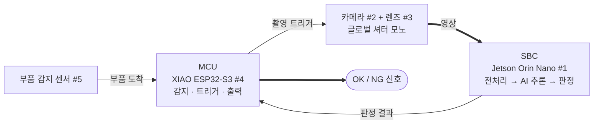
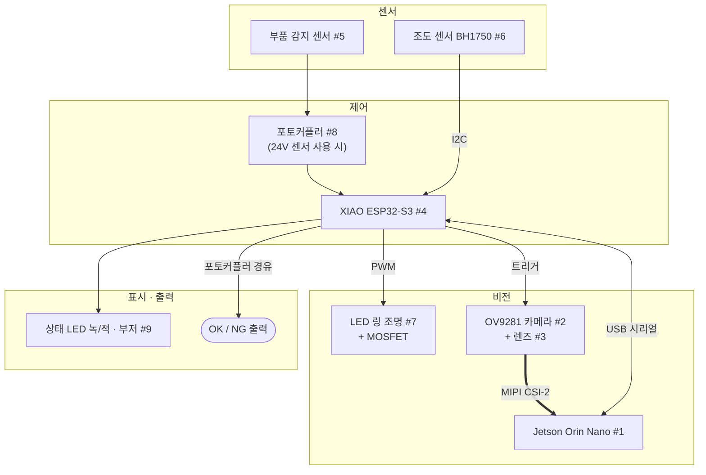
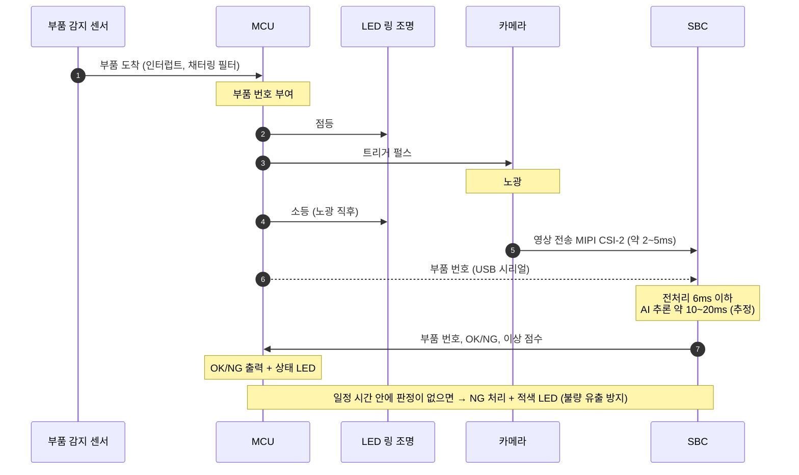
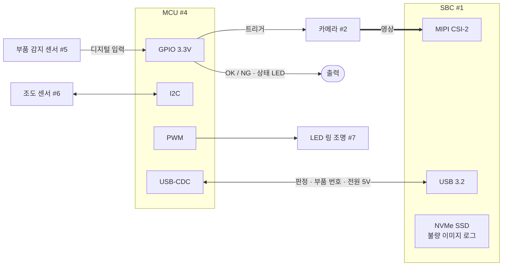
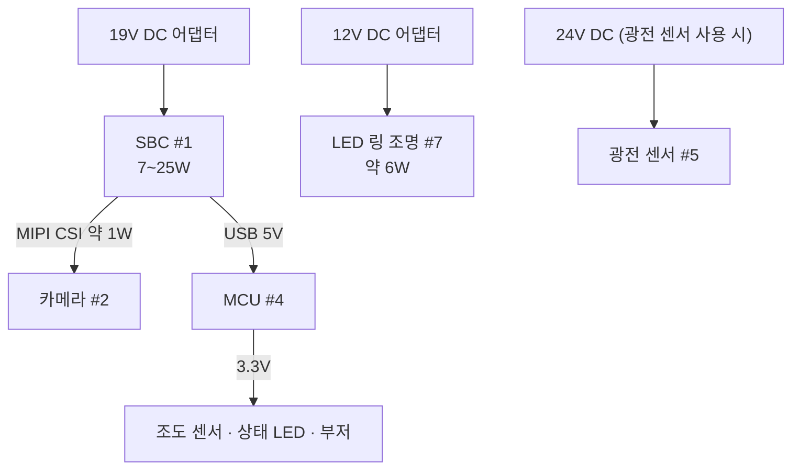
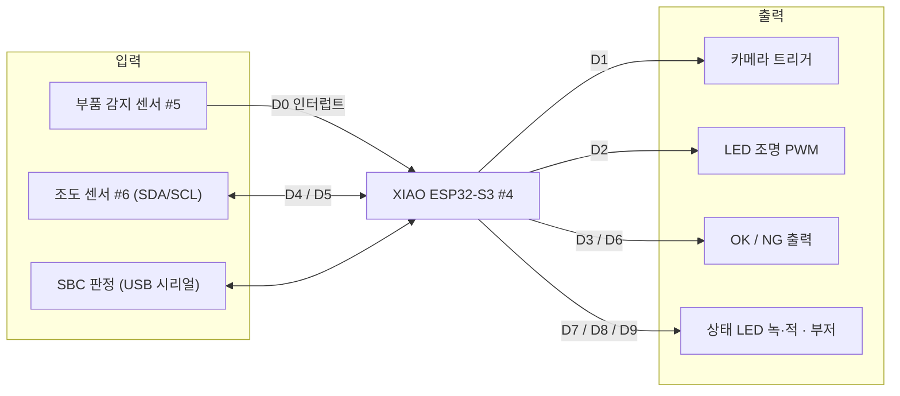
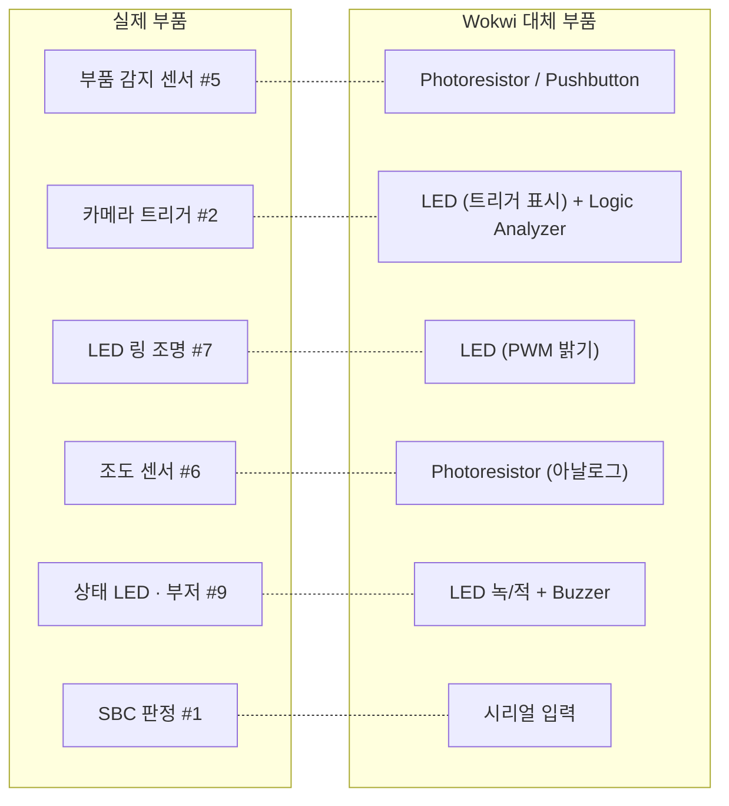

# [다이어그램] 비전 QC 검사 유닛 하드웨어 구성

| 항목 | 내용 |
| :--- | :--- |
| **문서 유형** | 하드웨어 구성 설명용 다이어그램 |
| **작성 일자** | 2026.10.14 |
| **기준 문서** | `report/hardware_components_report.md` (부품 사양·수치의 원본) |
| **범위** | 검사 유닛 1개 (카메라 + MCU + SBC), 판정 신호 출력까지 |

> 다이어그램은 Mermaid로 작성되어 GitHub, VS Code(Markdown Preview Mermaid 확장), Notion 등에서 바로 그려집니다. 부품 번호(#1~#9)는 하드웨어 보고서 3장 BOM 번호와 같습니다.

---

## 1. 한눈에 보기

검사 유닛은 **눈(카메라)**, **손발(MCU)**, **두뇌(SBC)** 세 부분으로 나뉩니다. 시간이 정확해야 하는 일은 MCU가, 무거운 연산은 SBC가 맡습니다.

| 부분 | 하는 일 | 하지 않는 일 |
| :--- | :--- | :--- |
| **카메라** | 트리거를 받으면 한 장 촬영, 영상 전송 | 판단 |
| **MCU** | 부품 감지, 촬영·조명 타이밍, 판정 출력, 상태 표시 | 영상 처리 |
| **SBC** | 전처리, AI 추론, 판정, 불량 이미지 저장 | 타이밍이 중요한 GPIO 제어 |

---

## 2. 전체 구성도

---

## 3. 신호 흐름 (부품 1개 기준)

판정 목표는 **캡처부터 판정 신호까지 35ms 이내**입니다.

### 판정 지연 예산 (≤ 35ms)

```mermaid
gantt
    title 캡처 → 판정 신호 (예상 21~34ms)
    dateFormat x
    axisFormat %L ms
    section MCU
    감지 → 트리거 → 노광   :a1, 0, 2ms
    section 전송
    MIPI CSI-2 영상 전송   :a2, after a1, 5ms
    section SBC
    전처리                 :a3, after a2, 6ms
    AI 추론 (추정)         :crit, a4, after a3, 20ms
    section 출력
    SBC → MCU → 출력       :a5, after a4, 1ms
```

| 구간 | 예상 시간 | 비고 |
| :--- | :--- | :--- |
| 감지 → 트리거 → 노광 | ≤ 2ms | MCU 인터럽트 |
| 영상 전송 (MIPI CSI-2) | 약 2~5ms | USB 사용 시 약 5~10ms |
| 전처리 | ≤ 6ms | Jetson에서 재측정 필요 |
| AI 추론 | 약 10~20ms | **가장 큰 구간, 추정값** |
| SBC → MCU → 출력 | ≤ 1ms | USB 시리얼 짧은 메시지 |
| **합계** | **약 21~34ms** | 여유가 작으므로 추론 실측이 최우선 |

---

## 4. 통신 구성

| 연결 | 방식 | 전달 내용 | 시간 중요도 |
| :--- | :--- | :--- | :--- |
| 감지 센서 → MCU | 디지털 입력 (인터럽트) | 부품 도착 | 매우 높음 |
| MCU → 카메라 | 디지털 펄스 | 촬영 트리거 | 매우 높음 |
| MCU → LED 조명 | PWM (MOSFET) | 노광 동안 점등·밝기 | 높음 |
| 카메라 → SBC | MIPI CSI-2 (또는 USB UVC) | 영상 | 높음 |
| SBC ↔ MCU | USB 시리얼 | 부품 번호, OK/NG, 이상 점수 | 높음 |
| MCU → 외부 | 디지털 출력 (포토커플러) | OK / NG 신호 | 높음 |
| 조도 센서 → MCU | I2C | 밝기 값 | 낮음 |

* **트리거를 MCU가 내는 이유**: SBC(리눅스)에서 GPIO를 다루면 응답이 수~수십 ms 흔들려 촬영 시점이 일정하지 않습니다.

---

## 5. 전원 구성

| 계통 | 공급 대상 | 용량 |
| :--- | :--- | :--- |
| 19V DC | SBC → 카메라, MCU, 저전력 부품 | 약 25W |
| 12V DC | LED 링 조명 | 약 6W |
| 24V DC (선택) | 광전 센서 | 1W 미만 |

---

## 6. MCU 핀 배선

| 핀 | 신호 | 방향 |
| :--- | :--- | :--- |
| D0 | 부품 감지 센서 | 입력 (인터럽트) |
| D1 | 카메라 트리거 | 출력 |
| D2 | LED 조명 PWM | 출력 |
| D3 / D6 | OK / NG | 출력 (포토커플러 경유) |
| D4 / D5 | I2C SDA / SCL | 양방향 |
| D7 / D8 / D9 | 상태 LED 녹 / 적, 부저 | 출력 |

* **I2C 핀**: XIAO ESP32-S3의 기본 I2C 핀(D4 = SDA, D5 = SCL)에 맞췄습니다. 다른 핀을 쓰려면 펌웨어에서 `Wire.begin(SDA, SCL)`로 지정합니다.

---

## 7. 부품 목록 요약

| No | 분류 | 부품 | 전원 | 연결 대상 · 방식 |
| :--- | :--- | :--- | :--- | :--- |
| 1 | 연산 | SBC (Jetson Orin Nano) | 19V DC | 카메라 MIPI CSI-2, MCU USB |
| 2 | 비전 | 글로벌 셔터 모노 카메라 (OV9281) | SBC 공급 | SBC 영상, MCU 트리거 입력 |
| 3 | 비전 | 렌즈 | 없음 | - |
| 4 | 제어 | MCU (XIAO ESP32-S3) | USB 5V | 센서·카메라·조명·출력 GPIO, SBC 시리얼 |
| 5 | 센서 | 부품 감지 센서 | 3.3~24V | MCU D0 |
| 6 | 센서 | 조도 센서 (BH1750) | 3.3V | MCU I2C |
| 7 | 조명 | LED 링 조명 + MOSFET | 12V DC | MCU PWM |
| 8 | 인터페이스 | 포토커플러 모듈 | - | 24V ↔ 3.3V 절연 |
| 9 | 표시 | 상태 LED · 부저 | 3.3V | MCU GPIO |

---

## 8. 가상 테스트 매핑 (Wokwi)

실물 구매 전에 **MCU 로직**을 Wokwi에서 먼저 검증합니다. MCU는 실물과 같은 XIAO ESP32-S3이고, 카메라·SBC 판정은 버튼이나 시리얼 입력으로 대신합니다.

| 테스트 | 폴더 | 상태 |
| :--- | :--- | :--- |
| 01 보드 기본 동작 | `wokwi/01_board_basic` | 동작 확인 |
| 02 부품 감지 + 트리거 출력 | `wokwi/02_entry_sensor` | 작성 완료 |
| 03 엔코더 카운트 | `wokwi/03_encoder` | **현재 범위 밖** (컨베이어 제외로 사용 안 함) |
| 04 SBC 판정 수신 → OK/NG 출력 | - | 예정 |
| 05 조명 동기 + 조도 감시 | - | 예정 |

* **Wokwi로 검증할 수 없는 것**: 카메라 촬영, AI 추론, MIPI 전송. 이 부분은 실물 Jetson에서 따로 검증합니다.
